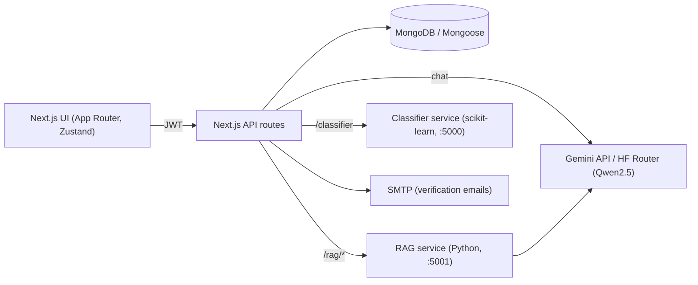

# SynapseAI

Full-stack AI workspace built with Next.js: multi-model chat, document Q&A (RAG), document classification, and a support-ticket system with role-based admin tooling.

   -orange)

## What it does

| Area | Details |
|---|---|
| **LLM chat** | Streaming and non-streaming chat routes, model catalogue endpoint, conversation history persisted per user. Providers: Gemini and Qwen2.5-7B-Instruct via the Hugging Face router. |
| **Document Q&A (RAG)** | Upload documents, retrieve relevant context from a RAG microservice, then answer with a category-aware system prompt (technical, financial, legal, scientific, business). |
| **Document classifier** | scikit-learn model served behind `/api/classifier` (single + batch, returns class probabilities). |
| **Auth** | Email/password + Google OAuth, JWT sessions, email verification, role model (user / admin / superadmin). |
| **Support & admin** | Ticket submission, admin dashboard, ticket management, notifications, user preferences. |

## System design



Design choices worth noting:

- **Thin API layer as a gateway.** Next.js routes own auth, validation and persistence; model-heavy work (RAG, classification) lives behind HTTP so it can be scaled and swapped independently.
- **Category-aware prompting.** The RAG query route picks a system prompt from the predicted document category, so the same retrieval pipeline answers like an analyst, lawyer or researcher depending on the corpus.
- **Provider abstraction for chat.** Chat requests are mapped from SynapseAI model names to provider models (Qwen2.5-7B-Instruct via the Hugging Face inference client), with a mock response when no token is configured so the UI runs offline.
- **Role-based access.** Signed JWTs carry the user's role (user / admin / superadmin).

## Run locally

```bash
git clone https://github.com/MahdiGH10/SYNAPSE-AI.git
cd SYNAPSE-AI
cp .env.example .env.local     # fill in your own keys
npm install
npm run dev                    # http://localhost:3000
```

Create the first admin once MongoDB is running:

```bash
MONGODB_URI=mongodb://localhost:27017/synapseai node scripts/create-admin.js you@example.com superadmin
```

The RAG and classifier services are separate Python processes (`RAG_SERVICE_URL`, `CLASSIFIER_SERVICE_URL`). They are **not included in this repository**; chat, auth and the ticket system work without them.

## Project layout

```
src/app/api/     chat, gemini, rag, classifier, auth, tickets, notifications, ...
src/app/         pages (dashboard, smart-chat, workspace, admin, support)
src/components/  UI components
src/models/      Mongoose models (User, Chat, Ticket, Post, ...)
src/lib/         jwt, db, email, llm and classifier clients
scripts/         admin bootstrap utilities
docs/            LLM architecture, ticket flow, setup notes
```

## Known limitations (honest status)

- The `/api/rag/*` routes currently check that an `Authorization` header is **present** but do not verify the JWT. Fix: call `verifyToken` and reject on failure.
- RAG and classifier microservices are not versioned here; the repo documents their HTTP contract only.
- No automated tests yet. Next step: Vitest for `lib/` and route handlers, Playwright for the auth flow.
- Earlier commits contained secrets in `.env.local`. They are removed from the current tree, but remain in git history, so those credentials must be treated as compromised and rotated.

## Author

**Mahdi Gharbi** — software engineering student, AI/automation. [GitHub](https://github.com/MahdiGH10) · [LinkedIn](https://linkedin.com/in/mahdi-gharbi-6891a5273)
