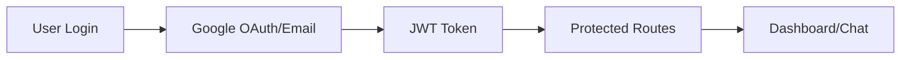

# 🛠️ Technical Implementation Guide

## Quick Setup Commands

### 1. Initial Setup (5 minutes)
```bash
# Clone and setup
git clone https://github.com/MahdiGH10/SYNAPSE-AI.git
cd SYNAPSE-AI
npm install
cd backend && npm install && cd ..

# Start development
# Terminal 1:
cd backend && npm run dev
# Terminal 2:
npm run dev
```

### 2. Environment Variables Needed
Create these files with your own values:

`.env.local` (root):
```env
NEXT_PUBLIC_API_URL=http://localhost:5000
NEXT_PUBLIC_GOOGLE_CLIENT_ID=your_google_client_id
```

`backend/.env`:
```env
NODE_ENV=development
PORT=5000
MONGODB_URI=mongodb://localhost:27017/synapseai
JWT_SECRET=your_super_secret_jwt_key
GOOGLE_CLIENT_ID=your_google_client_id
GOOGLE_CLIENT_SECRET=your_google_client_secret
```

## 🎯 Next Steps for AI Integration

### Priority 1: AI Chat Implementation
1. **Choose AI Provider**: OpenAI, Anthropic, or local models
2. **Add API Route**: Create `/api/chat/send` endpoint
3. **Stream Responses**: Implement streaming for real-time chat
4. **Message History**: Store conversations in MongoDB

### Priority 2: Enhanced Features
1. **File Upload**: PDF, image processing
2. **WebSocket**: Real-time bidirectional communication
3. **User Settings**: Personalization options
4. **Analytics**: Usage tracking and insights

## 🔍 Code Architecture Deep Dive

### Frontend Structure
```
src/
├── app/                    # Next.js App Router
│   ├── (auth)/            # Auth route group
│   ├── api/               # API routes
│   ├── chat/              # Chat interface
│   └── dashboard/         # User dashboard
├── components/            # React components
│   ├── ui/                # Base UI components
│   ├── auth/              # Auth-specific components
│   └── chat/              # Chat components
├── hooks/                 # Custom React hooks
├── lib/                   # Utilities and configurations
└── store/                 # Zustand state management
```

### Backend Structure
```
backend/
├── config/                # Configuration files
│   ├── db.js             # MongoDB connection
│   └── passport.js       # Passport strategies
├── controllers/           # Business logic
├── middleware/           # Custom middleware
├── models/               # Mongoose models
├── routes/               # Express routes
└── utils/                # Helper functions
```

## 🔧 Key Technical Components

### 1. Authentication Flow


### 2. State Management (Zustand)
- **chatStore.ts**: Messages, chat history
- **themeStore.ts**: Dark/light mode
- **workspaceStore.ts**: User workspace data

### 3. API Integration Pattern
```typescript
// Example API call structure
const response = await fetch('/api/endpoint', {
  method: 'POST',
  headers: {
    'Content-Type': 'application/json',
    'Authorization': `Bearer ${token}`
  },
  body: JSON.stringify(data)
});
```

## 🎨 Styling System

### Tailwind Configuration
- Custom color palette
- Animation utilities
- Responsive breakpoints
- Component variants

### Animation System
- Scroll-triggered animations
- Smooth page transitions
- Interactive hover effects
- Loading states

## 🔒 Security Implementation

### Current Security Measures
1. **JWT Authentication**: Stateless token-based auth
2. **Password Hashing**: Bcrypt with salt rounds
3. **CORS Policy**: Configured for development/production
4. **Input Validation**: Server-side validation
5. **Environment Variables**: Sensitive data protection

### Recommended Additions
1. **Rate Limiting**: Prevent API abuse
2. **CSRF Protection**: Cross-site request forgery
3. **Helmet.js**: Security headers
4. **Input Sanitization**: XSS prevention

## 🚀 Deployment Strategy

### Frontend (Vercel)
```bash
# Deploy command
vercel --prod
```

### Backend (Railway/Heroku)
```bash
# Railway deployment
railway login
railway link
railway up
```

### Database (MongoDB Atlas)
1. Create cluster
2. Setup network access
3. Create database user
4. Update connection string

## 🧪 Testing Strategy

### Recommended Testing Setup
```bash
# Install testing dependencies
npm install --save-dev jest @testing-library/react @testing-library/jest-dom
```

### Test Structure
```
tests/
├── components/           # Component tests
├── pages/               # Page tests
├── api/                 # API endpoint tests
└── utils/               # Utility function tests
```

## 📈 Performance Optimization

### Implemented Optimizations
1. **Next.js Image Component**: Automatic optimization
2. **Code Splitting**: Dynamic imports
3. **Font Optimization**: Local font loading
4. **Bundle Analysis**: Webpack bundle analyzer

### Future Optimizations
1. **Database Indexing**: MongoDB query optimization
2. **Caching Strategy**: Redis or memory caching
3. **CDN Integration**: Static asset delivery
4. **Lazy Loading**: Component-level lazy loading

## 🔍 Debugging Tips

### Common Issues & Solutions

1. **CORS Errors**
   ```javascript
   // backend/server.js
   app.use(cors({
     origin: process.env.FRONTEND_URL || 'http://localhost:3000',
     credentials: true
   }));
   ```

2. **MongoDB Connection Issues**
   ```bash
   # Check MongoDB status
   mongod --version
   # Restart MongoDB service
   sudo systemctl restart mongod
   ```

3. **Environment Variables Not Loading**
   ```bash
   # Verify .env files exist and syntax is correct
   cat .env.local
   ```

## 📊 Monitoring & Analytics

### Development Tools
1. **Next.js DevTools**: Built-in debugging
2. **React DevTools**: Component inspection
3. **MongoDB Compass**: Database GUI
4. **Postman**: API testing (collection included)

### Production Monitoring
1. **Vercel Analytics**: Frontend performance
2. **MongoDB Atlas Monitoring**: Database metrics
3. **Error Tracking**: Sentry integration (recommended)

## 🔄 Git Workflow

### Branching Strategy
```bash
main/master     # Production-ready code
develop         # Integration branch
feature/*       # Feature development
bugfix/*        # Bug fixes
hotfix/*        # Critical fixes
```

### Commit Convention
```
feat: add new chat interface
fix: resolve authentication bug
docs: update API documentation
style: improve mobile responsiveness
refactor: optimize database queries
```

## 📚 Additional Resources

### Documentation
- All markdown files in the repo contain specific guides
- Code comments explain complex logic
- API endpoints documented in backend/README.md

### External Resources
- [Next.js Best Practices](https://nextjs.org/docs/pages/building-your-application)
- [MongoDB Design Patterns](https://www.mongodb.com/blog/post/building-with-patterns-a-summary)
- [React Security Best Practices](https://snyk.io/blog/10-react-security-best-practices/)

---

**Ready to develop!** 🚀 The foundation is solid, well-documented, and ready for AI integration.